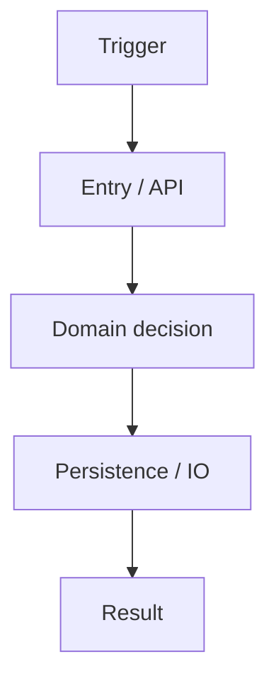
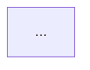

# PR Flow Story

Help a reviewer understand a big change **before** they drown in files.

Especially with AI-authored PRs (Claude, Cursor, Codex), the diff is often huge: many files, many tests. The job of this skill is not to nit every line. It is to:

1. Tell the **story** of the PR (why it exists, what outcome it claims).
2. Draw the **flow top-down** — what the system did before, what it does after, and what changed.
3. Say **where to focus** line-by-line vs what can stay skim-level.

This matches a practical review order: understand the picture → decide critical paths → only then deep-read. Design and dependency boundaries matter more than polish in leaf functions (leaf code is usually cheaper to fix later).

## Ground rules

- Prefer evidence from the diff and surrounding code over inventing architecture.
- If the change is too big to hold in one mental model, say so and recommend a split (see `stacked-pr-split` / `gh stack`). Asking the author to stack smaller PRs is normal, not a failure.
- Do not approve or reject the PR in this skill's output unless the user asked for a verdict. Deliver understanding first.
- Keep diagrams honest: label arrows with verbs; mark new / changed / removed paths.
- Output is a review brief the human (or another reviewer agent) can use immediately.

## 1. Gather context

Identify the change set:

```bash
# Open PR (preferred when available)
gh pr view <n> --json title,body,baseRefName,headRefName,files,additions,deletions,author,url
gh pr diff <n>

# Or local branch vs trunk
git fetch origin
git diff --stat origin/<trunk>...<head>
git log --oneline origin/<trunk>..<head>
git diff --find-renames origin/<trunk>...<head>
```

Also read:

- PR title + description (the author's claimed story).
- Ticket / issue links if present.
- Entry points touched: HTTP handlers, jobs, CLI, public APIs, schema/migrations.
- If the author is available and the intent is unclear, ask one short clarifying question about the **intended end-to-end flow** before deep analysis. Do not block forever on this — proceed with a best-effort story labeled as inferred.

## 2. Write the PR story

Produce a short story block (plain language):

| Field | What to write |
|-------|----------------|
| **Intent** | One sentence: what problem this solves or what capability it adds. |
| **Actor & trigger** | Who/what starts the flow (user, job, webhook, API client). |
| **Happy path** | 3–7 steps of the new end-to-end behavior. |
| **Out of scope** | What this PR deliberately does *not* change (if knowable). |
| **Risks claimed by the diff** | Auth, data migration, concurrency, backwards compatibility, blast radius. |

If the author's description disagrees with the diff, call that out explicitly.

## 3. Draw top-down before / after flow

Build **two** top-down diagrams (Mermaid `flowchart TD` by default), then a third "delta" view when helpful:

1. **Before** — the relevant existing path only (omit unrelated subsystems).
2. **After** — the same altitude, with new or changed nodes/edges.
3. **Delta (optional)** — only the edges/nodes that changed, colored or labeled `new` / `changed` / `removed`.

Rules for the diagrams:

- **Top-down**: start at the trigger; end at persistence, external IO, or user-visible result.
- One primary flow first. Secondary paths (errors, retries, feature flags) as thin side branches or a second small diagram — not spaghetti.
- Nodes are components or meaningful steps (handler → service → store), not every function.
- Edge labels are verbs (`validates`, `enqueues`, `writes`).
- If UI and backend both change, prefer one swim of control flow over a dump of every layer.

Example shape (replace with the real system):



When Mermaid is awkward (complex fan-out), use a numbered vertical list that still reads top-down, plus a smaller Mermaid for the critical slice.

## 4. Focus guide (what to read line-by-line)

From the diagrams, publish a **Focus** section with two lists:

### Read carefully (design & seams)

Prioritize:

- New or changed **module boundaries** and dependency direction (who imports whom).
- Public contracts: APIs, events, schemas, feature flags, config.
- Authn/authz, tenancy, PII, payment, destructive ops.
- Data migrations and backwards compatibility.
- Concurrency, idempotency, retries, timeouts.
- Places where AI likely "wired through" too many layers in one PR.

For each item: file path + symbol + **why it matters** (one line).

### Skim / defer

- Pure leaf helpers, formatting, obvious tests that mirror the happy path.
- Renames/moves with no behavior change (note them so nobody re-reviews noise).
- Generated code and lockfiles (mention size only).

Principle: **cheap to fix later → lower review priority.** Expensive architecture mistakes → higher.

## 5. Size check → split recommendation

If any of these hold, recommend splitting before (or instead of) a deep single-PR review:

- Hard to draw one coherent before/after without "and also…"
- Mixed concerns: refactor + feature + migration in one diff
- Reviewer cannot state the story in ≤3 sentences after reading the brief

Point to stacking small PRs that build on each other (`gh stack` / `stacked-pr-split`). If the author will not split, optionally produce a **virtual slice list**: ordered chunks the reviewer can mentally or locally review one at a time (foundations → core logic → wiring → surface), without rewriting git history unless asked.

## 6. Deliverable format

Write one brief (chat and/or `pr-flow-story.md` in the repo or `/tmp`) with this structure:

```markdown
# PR flow story: <title>

## Story
- Intent: …
- Actor & trigger: …
- Happy path: 1. … 2. …
- Out of scope: …
- Risks: …

## Flow before


## Flow after


## What changed in the flow
- …

## Focus (read carefully)
1. `path` / `symbol` — why
2. …

## Skim / defer
- …

## Split?
- No — single story holds.
- Yes — recommend stack / virtual slices: …
```

Optionally paste a short version as a PR comment if the user asked to post one. Do not post without being asked.

## 7. Optional: visuals and automated reviewers

Once the story and Mermaid focus map exist, you may also:

- Run **[visual-explainer](https://github.com/nicobailon/visual-explainer)** (`/diff-review`, `/generate-web-diagram`, slides) for a self-contained HTML page of the same change.
- Run other review tools or agents in parallel (bug-finding, style). Keep their findings **secondary** until the story and focus map exist — otherwise the human gets a pile of nits without a map. When both exist, attach automated findings under the Focus items they belong to.


## Related skills

- [stacked-pr-split](https://github.com/TomerCohen95/stacked-pr-split) — when the story does not fit one review, split into stacked PRs (`gh stack`).
- [visual-explainer](https://github.com/nicobailon/visual-explainer) — rich HTML / slides for the same understanding; especially `/diff-review` and `/generate-web-diagram`. Use **after** (or alongside) this skill’s story + Mermaid focus map when you want a browser-ready visual. Install: `npx skills add nicobailon/visual-explainer`.
- Optional: [PR Lens](https://github.com/coldteadotai/pr-lens) — animated architecture / data-flow walkthroughs inside the PR (GitHub App, Action, CLI, or skill).

## Anti-patterns

- File-by-file tour with no top-down story.
- Diagram that only restates folder names.
- Treating test volume as proof the design is sound.
- Blocking on micro-style while dependency edges are wrong.
- Silent approval of a mega-PR that should have been stacked.
